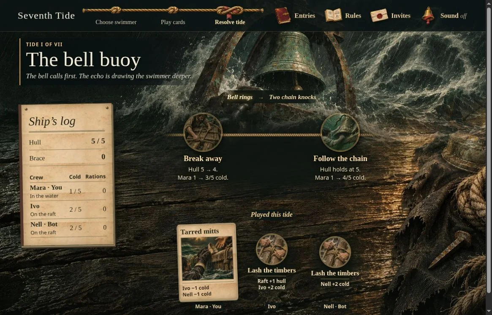

# Seventh Tide

Seventh Tide is a cooperative maritime horror card game for desktop browsers. Salvage what you can from a sinking ship, then keep three sailors alive for seven tides. Each tide, choose who swims, play equipment or a crew action, and decide how much hull or warmth you can afford to lose.

Play solo with two bots or invite one or two friends to join from their own devices.



## Run locally

Install [mise](https://mise.jdx.dev/installing-mise.html). Review [mise.toml](mise.toml) and run these commands from the repository root.

```sh
mise trust
mise install
mise run setup
mise exec -- npm run build
mise exec -- npm start
```

Open [127.0.0.1:4173](http://127.0.0.1:4173) and choose **Play solo**. Solo voyages save in the browser. To invite friends, start the server with PostgreSQL. [Host a crew voyage](docs/hosting.md)

## Guides

- [Playing Seventh Tide](docs/playing.md) explains the turn sequence, crew signals, and how to rejoin a voyage.
- [Development and verification](docs/development.md) covers the project layout, quality checks, simulations, and Bend laws.
- [UX guide](docs/ux.md) and [art notes](art/README.md) explain how the game looks and how to verify visual changes.

Report bugs or ask for help in [GitHub Issues](https://github.com/asabla/SeventhTide/issues).
